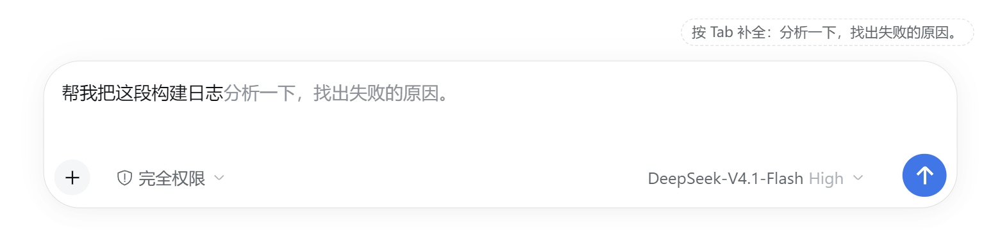

# dsh-composer-quill

**DSH 输入框里的续笔。** 回合结束时预测你下一句要说什么；打字时把你的半句话补完，顺手改掉错字和标点。建议是灰色文字贴在光标后面，**按 Tab 才采用，永远不会自动发送**。



它是 DeepSeek Harness（DSH）的一个插件，跑在本地，通过宿主已配置好的模型路由请求补全。

## 三种建议

| 类型 | 什么时候出现 | 怎么用 |
| --- | --- | --- |
| **下一句** | 一个回合刚结束，或你切回一个已聊过的会话（输入框为空） | `Tab` 采纳；多个候选时用 `←` `→` 换 |
| **补写** | 你打字停顿一下（默认 120 ms，**一个字就够**） | 灰字贴着光标；`Tab` 一次取完 |
| **改写** | 你打的字需要修整（错字、标点、一句话里塞了多个请求） | 建议整段替换你的草稿，`Tab` 采用 |

还有第四种，不花模型调用：**本地历史补全**。它拿你自己以前说过的话做前缀匹配，毫秒级给出灰字，模型结果一到就让位。

## 不会烦人的几件事

- **绝不自动发送。** 采纳只是把文字写进输入框，发不发送由你决定。
- **`Esc` 就是不要。** 关掉之后，同一份草稿不会再弹回来。
- **没变化就不花钱。** 同一段对话、同一份草稿、同一次设置，直接复用上一次的结果；只有真的发生了新回合才会重新问模型。
- **不会闪来闪去。** 请求进行中保留上一条建议，后面标「· 补写中…」，而不是清空等新的。
- **改一个字也接得上。** 建议还在屏幕上时你继续打字，灰字会实时收窄，不用重新请求。
- **中文输入法正常。** 组字期间不会打断你，也不会把组字内容当成草稿。

## 安装

需要 DSH `>=0.2.1-rc.2 <0.3.0`（不匹配的宿主会在安装阶段被拦下）。

```bash
# 直接从仓库装（不需要先 clone）
dsh plugin --profile desktop add github:yugyq/dsh-composer-quill
```

已经在本地开发的话，也可以指向目录：

```bash
dsh plugin --profile desktop add /path/to/dsh-composer-quill
```

桌面端也可以走界面：**设置 → 插件 → 添加插件 → 选这个目录**。

安装后**必须重启 DSH**（不是刷新页面）：客户端代码在启动时按版本号固定下来，刷新只会拿到旧的。想确认在跑哪一版，看日志里的 `build` 字段。

## 键位

| 按键 | 作用 |
| --- | --- |
| `Tab` | 采用当前建议（下一句 / 补写 / 改写 / 历史补全） |
| `←` `→` | 在多个候选之间切换（仅「下一句」有多候选时） |
| `Esc` | 关闭建议，本次草稿不再打扰 |
| `Ctrl+Shift+Space` | 手动要一条建议（「仅手动」模式下唯一入口） |
| `Enter` | 照常发送你的消息 |

## 设置

**设置 → 通用 → 续笔**

| 项 | 默认 | 说明 |
| --- | --- | --- |
| 启用 | 开 | 总开关 |
| 模式 | 自动 | 「仅手动」时只在按快捷键时请求 |
| 语言 | 跟随系统 | 跟随系统 / 中文 / English。**指定后强制**：草稿语言不同会翻译整段 |
| 停顿 | 120 ms | 打字后多久发请求，80–2000 |
| 超时 | 20000 ms | 单次请求超时，3000–60000 |
| 采纳反馈 | 自动 | 显示「已采纳/已展示」；`Tab` 采纳、`Esc` 忽略、没采纳就发送都计入，用于重排「下一句」候选 |

配置存在浏览器的 `localStorage` 里，不联网。

## 隐私

- **只在本机。** 没有自己的服务器：补全请求走宿主（DSH）已经配置好的模型路由，诊断日志写在本地 `~/.dsh/composer-quill.log`。
- **上下文出机器前先遮蔽凭据。** 拼进 prompt 的对话历史会先把九类凭据形状替换成 `[redacted …]`：私钥块、AWS `AKIA…`、GitHub `ghp_`/`github_pat_`、OpenAI `sk-…`、Stripe、Slack `xox…`、JWT、`Bearer …`。
- **你正在编辑的草稿不做遮蔽**，这是刻意的：建议是「草稿 + 尾巴」拼出来的，遮蔽会把 `[redacted]` 写进你要发的消息。
- **鉴权**：宿主侧的接口要求同一个 DSH 启动周期内的令牌，或同源浏览器请求；会话历史接口只认令牌。

## 它是怎么工作的

```
你的输入框 ──► 浏览器端插件 ──► 宿主路由 /composer-quill/predict
                    │                    │
                    │                    └─► 你已配置的模型，流式返回
                    └─► 灰色文字层（position: fixed，与正文同一行盒）
```

- 补写走 **SSE 流式**：模型一边生成，灰字一边变长，`Tab` 随时可采纳。
- 模型只回两种东西：要么是「接在草稿后面的尾巴」，要么是 `REWRITE:` 加一整条改写后的消息。
- 上下文是**按近因加权**的窗口：最后两轮主导，更早的对话只作为背景，且只保留一条与草稿相关的旧行。
- 建议与「草稿 + 对话版本 + 设置」绑定成缓存键；键不变就直接回放，键一变就作废。

细节见 [架构设计](docs/ARCHITECTURE.md) 与 [接口与流式协议](docs/PROTOCOL.md)。

## 已知限制

- **宿主没加载会话时没有上下文。** 刚启动或某些会话在宿主里还没有对话记录时，「下一句」和历史补全拿不到内容（日志里表现为 `empty-thread`），补写仍然可用。
- **一两个字的草稿只能猜。** 这种输入没有可续写的语义，插件会尽量给完整短句，但不可能猜准。
- 需要 DSH `>=0.2.1-rc.2 <0.3.0`；不匹配的宿主会在安装阶段就被拦下。

## 开发与测试

```bash
node smoke-test.mjs              # 57 项离线单测：解析、鉴权、缓存、流式帧序、语言闸
cd dev && python verify_daily.py # 24 个浏览器场景（自带模拟器，不需要真实 DSH）
```

真机脚本、审计探针和模拟器都在 `dev/`，用法见 [开发与验证](docs/DEVELOPMENT.md)。

## 诊断

出问题时先看 `~/.dsh/composer-quill.log`，每行一条 JSONL：

| 事件 | 含义 |
| --- | --- |
| `request` / `cache-hit` / `cache-miss` | 有没有真的调用模型；miss 会带上键的各个成分 |
| `result` | 返回了几条候选、失败原因（`skipped` / `empty-thread` / `wrong-language`） |
| `hydrated` | 复用了存储里的建议 |
| `next-ungrounded` / `next-empty` | 候选与会话无关、或一条都没剩下 |
| `dock-state` | 界面那一刻的完整状态（阶段、候选数、草稿是否为空…） |

## 许可证

[MIT](LICENSE)
