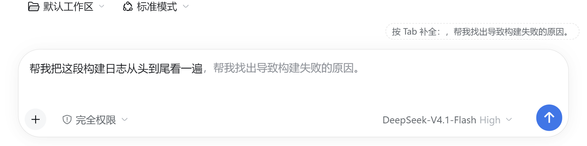

# 续笔 · dsh-composer-quill

**在 DSH 的输入框里，提前把话写好。**

一个回合刚结束，它猜你下一句要说什么；你打字打到一半，它把后半句补出来，顺手修掉错字和标点。



它是 DeepSeek Harness（DSH）的插件，完全在本地运行：请求走你已经在 DSH 里配置好的模型路由，没有第三方服务器。

## 四种建议

| 类型 | 什么时候出现 | 怎么用 |
| --- | --- | --- |
| **下一句** | 回合刚结束，或切回一个聊过的会话（输入框为空） | `Tab` 采纳；多候选用 `←` `→` 换 |
| **补写** | 打字停顿一下（默认 120 ms，一个字就够） | 灰字跟着光标，边打边收窄；`Tab` 一次取完 |
| **改写** | 你打的字需要修整时（错字、标点、一句话塞了多个请求） | 整段替换草稿，`Tab` 采用 |
| **历史** | 打字时立刻匹配你以前说过的话 | 不花模型调用，毫秒级出结果；模型结果到了就让位 |

## 它不会烦你

- **绝不自动发送。** 采纳只是把文字写进输入框，发不发由你决定。
- **`Esc` 就是不要。** 关掉之后，同一份草稿不会再弹回来。
- **没变化就不花钱。** 同一段对话、同一份草稿、同一份设置，直接复用上次的结果；真的发生了新回合才重新问模型。
- **不闪。** 请求进行中保留上一条建议，后面标「· 补写中…」，而不是清空重来。
- **边打边收窄。** 建议还在屏幕上时你继续打字，灰字实时缩短，不必重新请求。
- **输入法友好。** 组字期间不打断你，也不会把组字内容当成草稿。

## 安装

需要 DSH `>=0.2.1-rc.2 <0.3.0`（不匹配的宿主会在安装阶段被拦下），并且**已经在 DSH 里配好一个可用的模型**——插件不改装模型，只借用你现有的路由；没配模型时不会有任何建议。

```bash
dsh plugin --profile desktop add dsh-composer-quill        # 从 npm 装
dsh plugin --profile desktop add github:yugyq/dsh-composer-quill   # 或直接从仓库装
```

界面里也可以：**设置 → 插件 → 添加插件**，输入框填 `dsh-composer-quill`（想装尚未发布的改动就用 `github:yugyq/dsh-composer-quill`）。本地开发时填目录路径：`dsh plugin --profile desktop add /path/to/dsh-composer-quill`。

装完**必须重启 DSH**（不是刷新页面）：客户端代码在启动时按版本固定，刷新只会拿到旧的。想知道在跑哪一版，看日志里的 `build` 字段。

> 这是第三方插件，与 DeepSeek 官方没有隶属关系。遇到问题请开 [issue](https://github.com/yugyq/dsh-composer-quill/issues)，附上日志里相关的那几行。

## 键位

| 按键 | 作用 |
| --- | --- |
| `Tab` | 采用当前建议 |
| `←` `→` | 在多个候选之间切换（仅「下一句」有多候选时） |
| `Esc` | 关掉建议，本次草稿不再打扰 |
| `Ctrl+Shift+Space` | 手动要一条建议；「仅手动」模式下这是唯一入口 |

## 设置

**设置 → 通用 → 续笔**

| 项 | 默认 | 说明 |
| --- | --- | --- |
| 启用 | 开 | 总开关 |
| 模式 | 自动 | 「仅手动」时只在按快捷键时请求 |
| 语言 | 跟随系统 | 跟随系统 / 中文 / English。指定后强制——草稿语言不同会整段翻译 |
| 停顿 | 120 ms | 打字后多久发请求（80–2000） |
| 超时 | 20000 ms | 单次请求上限（3000–60000） |
| 采纳反馈 | 自动 | `Tab` 采纳、`Esc` 忽略、没采纳就发送都计入，用来重排「下一句」候选 |

配置存在浏览器的 `localStorage` 里，不联网。

## 隐私

- **只在本机。** 补全请求走 DSH 已配置的模型路由；诊断日志写在 `~/.dsh/composer-quill.log`。
- **上下文出机器前先遮蔽凭据。** 九类形状会被替换成 `[redacted …]`：私钥块、AWS `AKIA…`、GitHub `ghp_` / `github_pat_`、OpenAI `sk-…`、Stripe、Slack `xox…`、JWT、`Bearer …`。
- **正在编辑的草稿不遮蔽**，这是刻意的：建议由「草稿 + 尾巴」拼成，遮蔽会把 `[redacted]` 写进你要发的消息。
- **接口有鉴权。** 宿主侧要求本启动周期的令牌或同源浏览器请求；会话历史接口只认令牌。

## 它怎么工作

```
你的输入框 ──► 浏览器端插件 ──► 宿主路由 /composer-quill/predict
                     │                    │
                     │                    └─► 你配置的模型，流式返回
                     └─► 灰字层（position: fixed，与正文同一行盒）
```

- **流式**：补写走 SSE，模型边写灰字边长，`Tab` 随时可采纳。
- **两种回答**：要么是「接在草稿后面的尾巴」，要么是 `REWRITE:` 加一条改写后的整句。
- **近因加权**：上下文只看最后两轮，更早的对话只作背景，且只保留一条与草稿相关的旧行。
- **可判定的复用**：建议与「草稿 + 对话版本 + 设置」绑定成缓存键，键不变就回放，键一变就作废。

细节见 [架构设计](docs/ARCHITECTURE.md) 与 [接口与流式协议](docs/PROTOCOL.md)。

## 已知限制

- **宿主没加载会话时没有上下文。** 刚启动或某些会话在宿主里还没有对话记录时，「下一句」和历史补全拿不到内容（日志里是 `empty-thread`），补写仍然可用。
- **一两个字的草稿只能猜。** 没有可续写的语义，插件会尽量给完整短句，但猜不准。

## 开发与测试

两套测试都不需要真实的 DSH 环境：

```bash
npm test                          # 67 项离线单测：解析、鉴权、缓存、流式帧序、语言闸、输入清洗
npm run test:ui                   # 32 条浏览器场景（自带模拟器，含真实节奏回归）
npm test -- --filter=transcript   # 只跑某个行为
npm test -- --list                # 列出全部用例名
```

真机脚本、审计探针和模拟器都在 `dev/`，用法见 [开发与验证](docs/DEVELOPMENT.md)。

## 诊断

出问题先看 `~/.dsh/composer-quill.log`，每行一条 JSONL：

| 事件 | 含义 |
| --- | --- |
| `request` / `cache-hit` / `cache-miss` | 有没有真的调用模型；miss 会记下键的各个成分 |
| `result` | 返回了几条候选；失败原因是 `skipped` / `empty-thread` / `wrong-language` |
| `hydrated` | 复用了存储里的建议 |
| `next-ungrounded` / `next-empty` | 候选与会话无关，或一条都没剩下 |
| `dock-state` | 界面那一刻的完整状态：阶段、候选数、草稿是否为空 |

## 许可证

[MIT](LICENSE)

